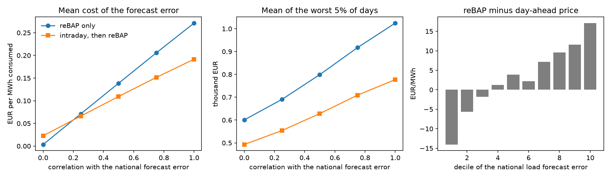

# Energy supplier hedging, structured products and portfolio risk (Germany)

How should a German electricity supplier buy the power it has sold at a fixed price, what are a
tolling agreement, a gas swing contract and a solar PPA worth, and how well do standard Value at
Risk models hold up on energy positions? This repository answers these questions on open data
(SMARD, EEX, Yahoo Finance TTF, DWD-based temperatures) with one consistent set of forward curves.

**Status:** v0.3, research study on public data. Forward curves are **modelled**, not exchange
settlement prices (see below), so levels that depend on forwards are illustrative; mechanisms,
comparisons and backtests are the point.

## Contents

| Part | What | Code |
|---|---|---|
| Forward curves | Two-factor spot model (Schwartz-Smith, Kalman filter) anchored to fuel cost, hourly price forward curve (HPFC), Cal/Quarter/Month base and peak products | `src/ehr/curves.py` |
| Customer book | BDEW standard load profiles H0 and G0, weather-driven volume from a load-temperature regression | `src/ehr/book.py` |
| Hedging programme | Five procurement strategies, hourly settlement of hedges and open position, P&L and P&L explain, 2021-2025 backtest | `src/ehr/hedging.py`, `scripts/run_backtest.py` |
| Structured products | Tolling (strip of Kirk spread options), gas swing (trinomial tree), solar pay-as-produced PPA, guarantees of origin | `src/ehr/products.py`, `src/ehr/goo.py`, `scripts/run_products.py` |
| Market risk | VaR and ES by historical, EWMA, filtered historical and Monte Carlo t simulation; Kupiec, Christoffersen and Acerbi-Szekely backtests; stressed VaR | `src/ehr/risk.py`, `scripts/run_risk.py` |
| Balancing group (v0.3) | Day-ahead forecast error of metered customers at reBAP, intraday correction at ID-AEP | `src/ehr/balancing.py`, `scripts/run_balancing.py` |
| Data and reporting | Input data checks and anomaly detection, DuckDB position store, SQL KPIs and position reconciliation, Excel report, Power BI tables | `src/ehr/quality.py`, `sql/`, `scripts/run_reporting.py` |

## Data

| Series | Source | Use |
|---|---|---|
| Day-ahead price DE-LU, load, wind, solar, hourly 2019-2025 | SMARD (Bundesnetzagentur), CC BY 4.0 | spot, settlement, curve fitting, profiles |
| TTF front-month future, daily | Yahoo Finance (TTF=F) | gas price, fuel cost |
| EU allowance primary auction prices, 2018-2025 | EEX auction reports | carbon cost |
| French guarantee of origin auctions, 2019-2026 | EEX (French state auctions) | GoO price |
| Daily mean temperature, ten German cities, 1991-2026 | Open-Meteo historical weather API (ERA5-based) | volume risk |
| Standard load profiles H0, G0 | BDEW via `demandlib` | expected customer volume |
| reBAP and ID-AEP, quarter hours, 2025-2026 | netztransparenz.de WebAPI of the TSOs (free client credentials in `NTP_CLIENT_ID`, `NTP_CLIENT_SECRET`) | balancing-group settlement |
| Grid load, load forecast and day-ahead price, quarter hours | SMARD, CC BY 4.0 | system forecast error |

Raw files are downloaded into `data/raw/` on first use and not committed.

## Forward curves: modelled, not exchange prices

Settlement history of EEX German power futures is not openly available (the exchange shows the
last 45 days). Forward prices on each past trading date are therefore built only from information
available on that date:

1. **Spot dynamics.** Log daily baseload price = seasonality + short-term factor (mean-reverting
   within days) + long-term level, fitted by maximum likelihood with a Kalman filter on the three
   years before the trading date. Seasonality is month of year and day class (public holidays as
   Sunday, the days between Christmas and New Year as Saturday), measured against a centred
   one-year moving average so that the 2022 crisis does not distort it. The likelihood has
   several local optima; each date is fitted from three starting points and the best is kept.
2. **Fuel anchor.** The long-term level reverts, at a rate estimated from monthly residuals, to the
   level implied by the short-run cost of a gas plant (1.82 x TTF + 0.365 x EUA) through a
   regression of monthly spot on that cost (elasticity mostly 0.55-1.0 from April 2020 on, up to
   1.4 in single months; the first fits in early 2020 have one year of data and are unstable). Gas
   and carbon are flat at their last price.
3. **Hourly shape.** Hourly factors by month, day type and hour from the last two years turn daily
   forwards into an HPFC, which gives base, peak and off-peak products.

Sanity check against realised prices (selected trading dates):

| Trading date | Modelled Cal next year | Realised baseload next year |
|---|---|---|
| 1 Jan 2021 | 44 | 235 (2022) |
| 3 Oct 2022 | 286 | 95 (2023) |
| 1 Jan 2024 | 86 | 89 (2025) |
| 1 Oct 2025 | 84 | not yet (2026) |

A forward is an expectation on the trading date, not a forecast that must match the outcome:
in October 2022 the exchange also priced Cal-23 far above what was later realised. Limits: no risk
premium, no information beyond spot and fuel prices; the correlation of the power forward with gas
is high by construction (0.97 in daily changes).

## Results

### 1. Hedging programme, delivery 2021-2025

Book: 300 GWh households (H0) plus 200 GWh commerce (G0) per year at a fixed energy price set on the
first trading day of October before delivery (load-weighted HPFC, no margin, so P&L is the
procurement outcome only). Actual volume moves with temperature: +0.47% per heating degree day
anomaly (t 6.2) and +0.59% per cooling degree day (t 8.6), from national grid load.

| Strategy | Mean P&L, EUR m/yr | Std, EUR m | Worst year, EUR m | Mean unit cost, EUR/MWh | Largest year-on-year cost jump, EUR/MWh |
|---|---|---|---|---|---|
| Spot only | 7.6 | 55.9 | -41.9 | 122.7 | 140.1 |
| Cal base + peak on the sales date | 0.2 | 1.3 | -1.1 | 137.7 | 188.4 |
| 12-month ladder, Cal base + peak | 14.4 | 18.5 | -1.0 | 109.2 | 154.4 |
| 12-month ladder, base only | 14.4 | 18.5 | -0.6 | 109.1 | 146.6 |
| 80% ladder + month products | 13.0 | 18.1 | -0.7 | 111.9 | 111.7 |

- **Hedging at the moment the price is fixed removes almost all P&L risk.** What remains
  (-1.1 to +2.1 EUR m a year on 500 GWh, -2 to +4 EUR/MWh) is shape and weather volume risk.
- **A ladder bought before the price is fixed is a position against the sales price.** It made
  money in 2022-2023 because prices rose after the tranches were bought; with falling prices it
  loses. It is the right tool when the tariff passes through the average procurement cost, where it
  smooths the cost: the ladder with month top-ups has the smallest year-on-year jump (112 against
  140-188 EUR/MWh).
- **Shape risk is small next to price risk here** (base-only against base + peak ladder), because a
  household and commerce profile is close to the base-peak block; it would matter for a solar-heavy
  or heat-pump book.
- The ladders shift the 2022 crisis into the 2023 cost (215-235 EUR/MWh), as many municipal
  utilities' tariffs did.

**P&L explain** (`results/pnl_explain.csv`): each year's P&L splits exactly (residual below
1e-13 EUR m) into a price level effect (sales price against the base spot average, on expected
volume), a shape effect (load-weighted against base spot), a weather volume effect and the hedge
result. The shape effect costs 0.9-3.1 EUR m every year because H0 and G0 consume more in expensive
hours; the weather volume effect stays below 0.5 EUR m; level and hedge dominate and offset each
other when the hedge is placed on the sales date (2022: level -40.2, hedge +44.0 EUR m).

### 2. Structured products, valued 1 December 2025 for 2026

Inputs: Cal-26 base 81.4, peak 85.3 EUR/MWh (modelled), TTF 28.8 EUR/MWh, EUA 83.0 EUR/t, TTF vol
43%, power-gas correlation of monthly changes 0.54.

| Product | Result |
|---|---|
| Tolling, 400 MW CCGT, daily spark-spread options | intrinsic 14.1 EUR m, option value 51.4 EUR m (128 EUR/kW/yr); hourly HPFC intrinsic 37.1 EUR m; peak block option 23.0 EUR m |
| Gas swing, Q1 2026, strike = forward | 2.2 EUR/MWh per right with 1 right, 1.8 with 30, 1.1 with 90 (every day, a strip of options) |
| Solar pay-as-produced PPA | fair price 48.2 EUR/MWh, capture rate 0.59; with the GoO price (0.33 EUR/MWh, French auction November 2025) the green bundle is 48.5 |

- The daily option strip is an upper bound for a real plant: start costs, minimum run and ramp
  limits are not modelled. Most of the value is extrinsic because the spark spread is close to zero
  at today's forwards.
- Swing flexibility is worth most per right when rights are scarce; the value per right falls as
  the holder has to exercise on worse days.
- **Solar capture risk is a trend, not noise.** Replaying each year's price and generation shape at
  the 2026 price level, the capture rate falls from 0.93 (2019 shapes) to 0.52 (2025 shapes). A
  buyer pricing on 2023-2025 shapes loses 6 EUR/MWh if 2026 looks like 2025.
- French GoO prices ran from 0.1-0.2 EUR/MWh (2020) to 7.9 (November 2022) and 0.2-2.0 EUR/MWh
  in 2025-2026: a small, volatile add-on to the power price.

### 3. Market risk, one-day VaR and ES, 2021-2025 (1,287 days)

Books: 10 MW Cal baseload power (power) and the same with the gas and allowances of a 55% CCGT sold
against it (clean spark spread). 250-day window.

| Book | Method | 99% exceptions (expected 12.9) | Kupiec p | Christoffersen cc p | ES Z2 | Basel light |
|---|---|---|---|---|---|---|
| power | historical | 30 | <0.001 | <0.001 | -1.74 | yellow |
| power | EWMA normal | 17 | 0.27 | 0.43 | -0.51 | green |
| power | filtered historical | 14 | 0.76 | 0.82 | -0.15 | green |
| power | Monte Carlo t | 16 | 0.40 | 0.57 | -0.02 | green |
| spark | historical | 26 | 0.001 | <0.001 | -1.25 | yellow |
| spark | EWMA normal | 30 | <0.001 | <0.001 | -2.23 | yellow |
| spark | filtered historical | 15 | 0.56 | 0.71 | -0.24 | green |
| spark | Monte Carlo t | 26 | 0.001 | 0.003 | -0.92 | yellow |

- **Plain historical simulation fails on both books:** after the 2021-2022 volatility jump its
  250-day window reacts too slowly and exceptions cluster.
- **Filtered historical simulation is the only method that passes everywhere**, including the ES
  test: it adapts the scale like EWMA and keeps the empirical fat tails and co-movements.
- **Normal and t models fail on the spread book.** A spread's loss distribution is driven by joint
  extremes of gas and power that an elliptical model with one covariance misses.

**Stressed VaR** (historical simulation on 2022 against the latest 250 days, `results/risk_stress.csv`):
99% one-day VaR of the power book 4.27 against 0.47 EUR m (worst 2022 day -7.2 EUR m), spark book
2.27 against 0.08 EUR m. A limit set on recent VaR alone would be about nine times too small for a
2022-type market on the outright book and almost thirty times on the spread book.

## v0.2: retail tariff, churn, industrial procurement, limits and counterparty credit

`src/ehr/retail.py`, `python scripts/run_retail.py`, results in `results/retail_*.csv`. Grid fee, sales cost, margin, demand elasticity, switching sensitivity and default probabilities are assumptions (parameters in the code); levies and taxes are the 2026 values of the transmission system operators and the statute (KWKG levy 0.446, offshore levy 0.941, levy for special grid use 1.559, electricity tax 2.05, concession fee 1.32 ct/kWh).

**Retail tariff** for a household customer: the energy cost of delivery year 2026 is 84.7 EUR/MWh (load-weighted modelled forward of the first trading day of October 2025). With the assumptions above the gross price is 33.1 ct/kWh: energy 8.5, procurement overhead 0.3, sales cost 2.2, margin 1.0, grid fee 9.5, levies 2.9, electricity tax 2.1, concession fee 1.3 and VAT 5.3 ct/kWh. Energy is about 30% of the gross price; a move of 20 EUR/MWh in the procurement cost moves the tariff by 2.4 ct/kWh (7%).

**Churn and elasticity** (structure only, no customer data). Annual churn is logistic in the gap to the market price (10% at zero gap), demand follows a constant elasticity, and the expected margin per customer is price minus cost times demand times the chance to keep the customer. The margin-maximising price falls from 25 to 14 ct/kWh when the switching sensitivity rises from 0.15 to 0.8 per ct (market price 12.5 ct against variable supply cost of 11.0 ct), and moves by at most 1.2 ct across elasticities of -0.1 to -0.4: churn matters more than demand elasticity for the price. The levels depend on the assumed base churn and sensitivity and are not estimates.

**Industrial buyer** (100 GWh per year, three shifts, 3% hourly load noise; delivery 2021 to 2025; `results/retail_industrial_summary.csv`). Budget = the load-weighted forward on the first trading day of October before delivery.

| Strategy | Mean cost, EUR/MWh | Std over the years | Worst overspend against budget, EUR m | Best, EUR m |
|---|---|---|---|---|
| Index (spot) | 120.2 | 66.2 | +8.8 | -19.3 |
| One purchase of the year (budget price) | 134.3 | 94.8 | +0.1 | -0.1 |
| 12 monthly tranches in the year before | 106.6 | 73.3 | +0.2 | -6.7 |
| 70% tranches, 30% index | 110.7 | 51.7 | +1.2 | -10.1 |
| 25% solar PPA (pay-as-produced) + tranches | 116.3 | 75.4 | +0.6 | -5.0 |

A single purchase gives budget certainty (the cost equals the budget by construction) and the highest average cost, because it fixed 288 EUR/MWh for 2023 in October 2022 against a realised 96. Tranches smooth the entry price. Keeping 30% on index has the lowest year-to-year spread of the cost here. The PPA share lowers the cost in the years with high spot prices and adds the shape effect of solar hours; with five delivery years these are illustrations of mechanisms.

**Limits** (`limit_report`). VaR limit of the supplier book = 1.25 times the 90% quantile of the daily filtered-historical VaR in the calm reference 2021 (2.36 million EUR); amber from 80% of the limit. Days in red per year: 7 (2021), 220 (2022), 0 (2023 to 2025); amber 18, 26 and 10 days in 2021 to 2023. A limit fixed in a calm year is breached on 85% of the days of the crisis year, so limits need a review rule and an escalation path, not only a level.

**Counterparty credit** (unilateral CVA of a long 3-year baseload forward at 80 EUR/MWh, 1 MW, volatility 35% decaying towards delivery, loss given default 60%, one-year default probabilities of 0.03% (AA) to 3.5% (B) as assumptions). Peak expected exposure is 86.5 thousand EUR; CVA is 0.003 EUR/MWh for A, 0.008 for BBB, 0.037 for BB and 0.141 for B; a collateral threshold of 50 thousand EUR lowers it by about 30%. For investment grade the credit charge is small against the commodity risk; below it, it is a pricing item.

## v0.3: balancing group of metered industrial customers

`src/ehr/balancing.py`, `src/ehr/imbalance_data.py`, `python scripts/run_balancing.py`, results in
`results/balancing_*.csv`. A German two-page summary of procurement and balancing is in
[docs/Beschaffungsportfolio_Bilanzkreis.pdf](docs/Beschaffungsportfolio_Bilanzkreis.pdf).

A supplier buys its day-ahead load forecast for 100 GWh a year of metered industrial customers (the three-shift
profile of v0.2) and settles every quarter-hour deviation at the German imbalance price (reBAP). Period: January
2025 to September 2026, 61,240 quarter hours, real reBAP, intraday index ID-AEP, day-ahead prices and national
load data. The forecast error is synthetic: standard deviation 3% (assumption), made of a share that follows the
published national load forecast error (correlation `s`, assumption) and an independent AR(1) part (hourly
autocorrelation 0.9, assumption). Standard-load-profile customers (the H0 and G0 book of v0.1) are outside this
study: their deviations are settled with the distribution system operator (Mehr-/Mindermengen), not in the
supplier's quarter-hour balance.

The intraday correction trades the expected deviation 75 minutes ahead, estimated from the last known quarter hour
with a coefficient fitted on the previous 28 days, at ID-AEP plus 1 EUR/MWh half spread. Mean over 200 random
draws of the independent part:

| Correlation with the national error | reBAP only, EUR/MWh | Worst 5% of days, kEUR | With intraday correction, EUR/MWh | Worst 5% of days, kEUR |
|---|---|---|---|---|
| 0 | 0.00 (-0.06 to 0.07) | 0.60 | 0.02 | 0.49 |
| 0.5 | 0.14 (0.08 to 0.19) | 0.80 | 0.11 | 0.63 |
| 1 | 0.27 | 1.02 | 0.19 | 0.78 |

(brackets: 5th to 95th percentile of the draws)

- **An error that is independent of the system costs almost nothing on average; an error that moves with the
  national one does.** With a single imbalance price, short and long deviations offset in expectation unless they
  coincide with the system's: reBAP minus day-ahead goes from -14 EUR/MWh in the lowest decile of the national
  load forecast error to +17 in the highest. The correlation is weak (0.07) but enough: the fully correlated case
  costs 0.27 EUR/MWh (27 thousand EUR a year), above all 84 placebo runs in which the same error series is moved
  by whole weeks (mean 0.00, 95th percentile 0.06).
- **The risk is there even when the mean cost is zero**, and it is concentrated: in the fully correlated case the
  ten most expensive of 638 days carry 44% of the total cost.
- **Intraday correction halves the open energy** (2.4% to 1.1% of consumption at correlation 0.5) and lowers the
  mean of the worst 5% of days by about a fifth. It lowers the mean cost only if the errors are correlated with the
  system; at correlation 0 it pays the spread for nothing.
- **It depends on the spread and on fresh meter data.** At correlation 0.5 the mean saving disappears above about
  2.4 EUR/MWh half spread (`results/balancing_sensitivity.csv`). Even a deviation known exactly in time and closed
  at ID-AEP still costs 0.14 EUR/MWh in the fully correlated case: intraday prices already carry part of the shared
  error.
- All costs scale linearly with the assumed size of the error.



Limits of v0.3: synthetic customer errors (no meter or forecast data of a supplier); the national load forecast
error as the only system link (wind and solar errors, which move reBAP more, are priced in
[de-weather-to-power](https://github.com/serikov-power-markets/de-weather-to-power)); ID-AEP is an index, not an
executable quote; meter data within a quarter hour is assumed for the intraday correction; no collateral, fees or
the balancing-group contract's penalties. The balancing duty itself (for example the obligation of
BNetzA decision BK6-19-212 to close open positions before delivery) means a supplier may not leave positions open
on purpose to earn the imbalance spread; the study measures the cost of unavoidable errors.

## Data checks and reporting

`scripts/run_reporting.py` checks every input: hours per local day (23/24/25 with daylight saving),
duplicates, bounds, stuck values and robust anomalies against the same hour on the same kind of
day (results/data_quality.csv). All series are complete, with no duplicates and correct hour counts
on daylight-saving days. Robust anomalies (more than 8 robust standard deviations): price 364
(spikes and negative-price hours), load 137 (for example Easter Saturday, bridge days and Corpus Christi,
a regional holiday not in the national calendar), wind onshore 101, offshore 15, solar 330.
SMARD fills some night hours of solar with constant values of 1 to 6 MWh; these are not counted as
a stuck feed. The EUA series has nine gaps over five days, at the auction breaks around Christmas
and in August.

Market data, the customer book, the trade blotter (all strategies) and hourly positions go into
DuckDB. `sql/reconcile.sql` rebuilds the hourly position from the blotter and compares it with the
Python position (0 differences); `sql/kpi.sql` computes monthly hedge ratio, open volume, average
hedge price and unit cost, which match the Python settlement to 0.0001 EUR/MWh. Outputs: an Excel
report (`results/kpi_report.xlsx`) and fact and dimension tables for a Power BI model
(`results/powerbi/`).

## Run

```
python -m venv .venv
.venv/Scripts/pip install -e .[test]      # Linux/macOS: .venv/bin/pip
python scripts/build_curves.py            # monthly curve fits, about 3 minutes
python scripts/run_backtest.py
python scripts/run_products.py
python scripts/run_risk.py
python scripts/run_reporting.py
python scripts/run_balancing.py     # needs the netztransparenz credentials on the first run
pytest
```

## Limitations

- Modelled forwards (above); no risk premium; gas and carbon curves flat at the front price.
- Retail book without churn, new customers or price-adjustment clauses; weather sensitivity from
  national grid load, not from a household panel.
- Tolling without unit commitment constraints; swing on a one-factor model calibrated to the
  front-month future rather than day-ahead gas; PPA capture risk from historical shapes, volume
  risk of a single asset not modelled.
- Price-taker throughout; no transaction costs, collateral or credit risk.
